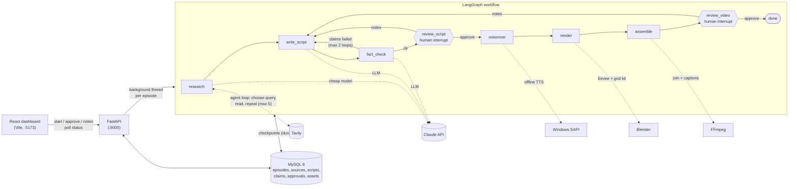

# Breaking Point Studio

A human-in-the-loop **agentic workflow** (built with LangGraph) that makes YouTube Shorts for the channel
**"The Breaking Point"**. Claude-powered steps are chained in a graph with loops and two human approval gates, and
the research step is a real tool-using agent. It is not a team of autonomous agents: see
[What is and isn't an agent](#what-is-and-isnt-an-agent).

Each episode puts **one object** through **10 escalating levels** of one hazard (heat, cold, pressure, impact speed,
lightning or spin) until it fails. Every level has a real measured value and a **SURVIVES / DESTROYED** verdict, and each
episode has one surprising **twist level**.

You type a topic such as *"A grain of sand vs 10 levels of speed"*, click **Start**, and the system:

1. a **research agent** (cheap Claude + the Tavily search tool) chooses its own web searches (at most 5) to find real
   values from harmless to destructive plus one surprising fact,
2. writes a structured 10-level script with Claude (validated, with one automatic retry if the output is invalid),
3. fact-checks every claim against its source with Claude (and sends failures back for a rewrite),
4. **pauses for your review** of the script (approve, or send notes; approving a script with failed claims asks you
   to confirm),
5. records a voiceover, renders one 3D shot per level in Blender, and assembles a 1080x1920 MP4 with captions,
6. **pauses again** for your final approval of the video.

> Status: the walking skeleton works end to end (one real run completed). Visuals and voice are deliberately simple;
> see the [roadmap](#roadmap).

## Architecture



**Why it is built this way**

- **LangGraph** runs the steps as a graph with loops (fact-check, notes) and two *interrupts* where a human decides.
- **MySQL checkpointer**: the graph's state is saved after every step, so a crash or restart resumes where it stopped.
  The readable tables (episodes, scripts, claims, ...) sit beside LangGraph's own checkpoint tables.
- **Background runner**: rendering takes minutes, so FastAPI runs each episode in a thread and the dashboard polls.
- **Cheap model for simple work**: Claude Haiku runs the research agent and the fact-check; Claude Sonnet writes the script.
- **Mock mode**: with no API keys (or `MOCK_LLM=1` / `MOCK_SEARCH=1`) the pipeline uses fake research and a fake
  script, so you can test everything for free. (The research agent needs both keys, so with either one missing or
  forced to mock, research uses clearly labelled fake searches.)

## What is and isn't an agent

In simple terms: an *agent* is an AI that is given tools and a goal, and itself decides what to do next (which tool to
call, with what input, and when it is finished), in a loop. A *workflow* is a fixed route that the code decides in advance.

| Step | What it is today |
|---|---|
| `research` | **A real agent.** Claude (the cheap model) gets the `web_search` tool (Tavily) and a goal: find real measured values across the hazard's full range, harmless to destructive, plus one surprising fact for the twist. It chooses its own queries, reads the results, searches again to fill gaps, and decides when it has enough. Hard limit: 5 searches, enforced in the tool itself. Every query it chose is saved in MySQL (`research_queries`) and shown on the episode page. |
| `write_script` | One Claude call that fills in a structured form (no tools). Its output is validated by code; if invalid it is retried once with the validation error. |
| `fact_check` | One Claude (Haiku) call that judges each claim against its source text (no tools). |
| `review_script`, `review_video` | A human decides (LangGraph interrupt). |
| `voiceover`, `render`, `assemble` | Plain code driving Windows TTS, Blender and FFmpeg. |

The loops between the other steps (fact-check failed, so rewrite; reviewer sent notes, so rewrite; invalid output, so
retry) are real, but the *code* decides when to loop (a counter, a validator, the human's button), not the AI. So the
project is an LLM-powered workflow with human-in-the-loop control, with exactly **one** tool-using agent (research)
inside it. The agent is deliberately small and capped (one tool, 5 searches) so its cost stays predictable.

## Project layout

| Folder | What it holds |
|---|---|
| `backend/bp/` | LangGraph graph (`graph.py`, `nodes/`), FastAPI (`api.py`), background runner, MySQL (`db.py`) |
| `frontend/` | React dashboard: episode list, script review, video page |
| `blender/` | `render_level.py` (one shot per level) and `kit/` (the grid look: `grid_kit.py`, `STYLE.md`) |
| `scripts/` | Starts the project's own MySQL 8 |
| `output/` | Generated audio, renders and videos (git-ignored) |

## Requirements (Windows)

- Python 3.12, Node.js 20+, FFmpeg on `PATH`
- MySQL **8.x** (the project runs its own copy on port **3307**, so it never touches another MySQL on 3306)
- Blender 5.2 (path set in `.env`)
- An Anthropic API key and a Tavily key (Tavily has a free tier). Neither is needed for mock mode.

The voiceover uses Windows' built-in offline text-to-speech, so the pipeline is Windows-only for now.

## First-time setup

```bat
:: 1. Python environment
python -m venv .venv
.venv\Scripts\python -m pip install -r backend\requirements.txt

:: 2. Dashboard packages
cd frontend && npm install && cd ..

:: 3. Settings: copy the template, then fill in the key lines in .env yourself
copy .env.example .env
```

4. **MySQL.** Create the data folder once, start the server, then create the database and an app user (replace
   `CHOOSE_A_PASSWORD`, and put the same value on the `MYSQL_PASSWORD=` line of `.env`):

   ```bat
   "C:\Program Files\MySQL\MySQL Server 8.4\bin\mysqld.exe" --initialize-insecure --basedir="C:\Program Files\MySQL\MySQL Server 8.4" --datadir="%CD%\mysql-data"
   scripts\start_mysql.bat
   ```

   ```sql
   -- run with:  "C:\Program Files\MySQL\MySQL Server 8.4\bin\mysql.exe" -u root -P 3307 -h 127.0.0.1
   CREATE DATABASE breaking_point CHARACTER SET utf8mb4;
   CREATE USER 'bp_app'@'localhost' IDENTIFIED BY 'CHOOSE_A_PASSWORD';
   GRANT ALL ON breaking_point.* TO 'bp_app'@'localhost';
   ```

   The empty-password `root` account is for local development only; the server listens on `127.0.0.1` only.
   The tables are created automatically on the first start.

## Run it

Double-click **`start.bat`** (or **`start_mock.bat`** for a free test run with fake research and script). It starts MySQL,
the backend (http://localhost:8000, API docs at `/docs`) and the dashboard, then opens http://localhost:5173.

> From a terminal, type `.\start.bat`. Plain `start.bat` is mistaken for cmd's built-in `start` command.

Then in the dashboard:

1. Enter a topic and click **Start**.
2. When the status says *Needs script review*, read the script and each claim's source link, then **Approve** or
   **Send notes** (notes are required and make Claude rewrite).
3. Rendering takes about 5 minutes. When the status says *Needs video review*, watch the video, download it, and
   give the final **Approve**.

Command-line alternative (no dashboard): `cd backend` then `..\.venv\Scripts\python -m bp.cli "topic" --auto`.

**Cost note:** a real run calls Claude (Haiku for the research agent and fact-checks, one Sonnet script per draft)
and Tavily (at most 5 searches per episode). Notes and
fact-check loops add more drafts. Use mock mode while testing.

## Roadmap

- **Done: research is a tool-using agent** (cheap model + Tavily, max 5 searches, queries saved and shown in the
  dashboard); script validation with one retry; the prompt demands the full value range and a real twist; the dashboard
  asks for confirmation before approving a script with failed claims.
- **Deeper research agent**: add a page-reader tool so it can open a source instead of relying on search excerpts, and
  let fact-check use the agent's findings, not only the excerpts.
- **Better voice**: replace Windows SAPI with a neural text-to-speech voice; sync the verdict flash to the spoken word.
- **Better visuals**: real objects instead of a sphere, richer per-hazard effects (melting, cracking, shattering),
  higher Eevee quality, camera moves, sound effects and music.
- **Visual QA**: automatically check sampled frames (is the object visible, do captions fit, does the verdict match
  the script) before the video reaches the human.
- **Evals**: score scripts for escalation, a real twist and source support (today only a simple validator checks the
  basics); track fact-check pass rate and cost per
  episode; regression-test prompts.
- **Analytics**: pull Shorts performance back in (retention, views per hazard) to choose the next topic.
- **Publishing**: upload to YouTube after final approval; cross-platform (non-Windows) voiceover.
